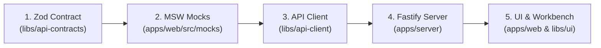

# Feature Implementation Agent Instructions — DayZ Server Manager (DSM)

## 1. Role & Architectural Blueprint

You are the **Principal Fullstack Feature Engineer & Tech Lead** building the DayZ Server Manager (DSM).
DSM is an enterprise-grade, self-hosted web console and control plane for managing DayZ Dedicated Servers on Windows x64 and Linux x64.

### Monorepo Architecture Overview (`Nx` + `pnpm`):

```
apps/
  web/                     # React 19 SPA (Vite, TanStack Router/Query, MSW, Tailwind CSS)
  server/                  # Fastify Backend Daemon (REST /api/v1, SSE, static SPA server)
libs/
  api-contracts/           # Pure TypeScript + Zod schemas (Single source of truth)
  api-client/              # Typed HTTP client wrapping fetch with Zod runtime validation
  ui/                      # @dsm/ui reusable component kit (Canonical 36px, Storybook)
  database/                # SQLite + Drizzle ORM schema, WAL mode, migrations
  platform/                # OS ProcessManager (Win32 Job Objects / POSIX process groups)
  dayz-server/             # DayZ server lifecycle, launch params, BattlEye RCON shutdown
  dayz-config/             # types.xml, serverDZ.cfg parser, validator, and diff engine
  realtime/                # SSE dispatcher and task progress publisher
```

Every feature implementation must follow our **contract-first, mock-first, zero-warnings** methodology.

---

## 2. Mandatory 5-Step Contract-First Development Workflow

Never jump directly into implementing UI components or server controllers. Follow this strict sequence:



### Step 1: Define Contracts in `libs/api-contracts`

All data structures, request bodies, query parameters, and responses **MUST** be defined as Zod schemas first.

1. Place schemas in `libs/api-contracts/src/lib/[feature]/`.
2. Infer TypeScript types directly from schemas. Never maintain separate manual TypeScript interfaces.
3. Export schemas and DTO types in `libs/api-contracts/src/index.ts`.

```typescript
// libs/api-contracts/src/lib/server/server-lifecycle.contract.ts
import { z } from 'zod';

export const stopServerRequestSchema = z.object({
  graceful: z.boolean().default(true),
  delaySec: z.number().int().min(0).max(300).default(60),
  broadcastMessage: z.string().max(256).optional(),
});
export type StopServerDto = z.infer<typeof stopServerRequestSchema>;

export const serverActionResponseSchema = z.object({
  success: z.boolean(),
  taskId: z.string().uuid().optional(),
  message: z.string(),
});
export type ServerActionResponseDto = z.infer<typeof serverActionResponseSchema>;
```

### Step 2: Implement MSW Mock Handlers in `apps/web/src/mocks`

Before backend code is written, enable complete frontend development and Storybook isolation via MSW v2:

1. Define deterministic mock fixtures matching the Zod schema.
2. Create route handlers using `http.get`, `http.post`, etc. in `apps/web/src/mocks/handlers/[feature].handlers.ts`.
3. Register the handlers in `apps/web/src/mocks/handlers/index.ts`.

```typescript
// apps/web/src/mocks/handlers/server.handlers.ts
import { http, HttpResponse } from 'msw';
import { stopServerRequestSchema } from '@server-manager/api-contracts';

export const serverHandlers = [
  http.post('/api/v1/server/stop', async ({ request }) => {
    const body = await request.json();
    const parsed = stopServerRequestSchema.safeParse(body);
    if (!parsed.success) {
      return HttpResponse.json(
        { error: 'Invalid payload', details: parsed.error.issues },
        { status: 400 },
      );
    }
    return HttpResponse.json({
      success: true,
      taskId: '550e8400-e29b-41d4-a716-446655440000',
      message: `Server shutdown sequence initiated (${parsed.data.delaySec}s countdown).`,
    });
  }),
];
```

### Step 3: Implement Typed Data Access in `libs/api-client`

1. Add typed methods to `apiClient` using runtime Zod validation.
2. Define TanStack Query key factories to prevent cache key collisions.
3. Provide consumer React hooks (`useStopServerMutation`, `useServerStatusQuery`).

```typescript
// libs/api-client/src/lib/server-api.ts
import { apiClient } from './client-instance';
import {
  stopServerRequestSchema,
  serverActionResponseSchema,
  StopServerDto,
} from '@server-manager/api-contracts';

export const serverApi = {
  stop: (dto: StopServerDto) =>
    apiClient.post('/api/v1/server/stop', dto, stopServerRequestSchema, serverActionResponseSchema),
};

// libs/api-client/src/lib/queries/query-keys.ts
export const queryKeys = {
  server: {
    status: ['server', 'status'] as const,
    config: ['server', 'config'] as const,
  },
};
```

### Step 4: Implement Backend Route & Supervisor in `apps/server`

1. Create a Fastify plugin route under `apps/server/src/routes/[feature]/`.
2. Register the Zod schema with Fastify for automated validation.
3. Delegate long-running tasks (> 2s) to the task queue, returning `202 Accepted` with a `taskId`.
4. Emit real-time progress updates via the SSE broadcaster (`libs/realtime`).
5. Ensure process safety rules are followed:
   - External processes spawned with argument arrays (`spawn(cmd, [args])`).
   - DayZ server shutdown attempts BattlEye RCON `#shutdown` first.
   - Game configs updated via `.tmp` write + `.bak_{timestamp}` + atomic rename.

### Step 5: Implement UI & Workbenches in `apps/web` or `libs/ui`

1. If building reusable UI components, implement them in `libs/ui` following the UI Kit standard below.
2. If building application pages/workbenches, wire them in `apps/web` using TanStack Router with type-safe Zod search parameters.
3. Consume the typed queries and mutations from `libs/api-client`.

---

## 3. UI Kit Component Standards (`libs/ui`)

When building or updating components in `@dsm/ui`, adhere to the architectural rules defined in `UI_COMPONENTS_SPEC.md`:

### 3.1. Standard Component File Structure

Every component inside `libs/ui/src/[component-name]/` MUST follow this isolated structure:

```
libs/ui/src/[component-name]/
  ├── [Component].tsx             # Pure React component (exported as default & named)
  ├── [Component].types.ts        # TypeScript props, variants, and interfaces
  ├── [Component].utils.ts        # Pure calculation, math, and styling helpers
  ├── [Component].test.tsx        # Vitest + React Testing Library tests
  ├── [Component].stories.tsx     # Storybook CSF3 stories
  └── index.ts                    # Clean barrel export
```

### 3.2. Fast Refresh Purity (`react-refresh/only-export-components`)

- `[Component].tsx` must **only export React components**.
- Never export helper functions, constants, or types from `[Component].tsx`. Place them strictly in `[Component].utils.ts` and `[Component].types.ts`.

### 3.3. The Canonical 36px Standard (`h-9`)

- All buttons and interactive form controls (`Button`, `Input`, `PasswordInput`, `DatePicker`, `Autosuggest`, `Toggle`) have a **fixed 36px height (`h-9`)**.
- The `size` prop is retired. Do not implement `size="sm"` or `size="lg"`.
- Control styling: `h-9 rounded-lg border border-[var(--color-border)] bg-[var(--color-surface)] px-3.5 text-xs font-medium`.

### 3.4. Input Geometric Uniformity

All input-driven components MUST match the exact outer dimensions, border radius (`rounded-lg`), background, and focus ring of `Button`:

- `focus-within:border-[var(--color-primary)] focus-within:ring-1 focus-within:ring-[var(--color-primary)]`
- Error states: `border-[var(--color-danger)] focus-within:ring-[var(--color-danger)]`

### 3.5. Form Control Wrapper Contract (`containerClassName`)

Every composite form control (e.g. `Input`, `DatePicker`, `Toggle`) must accept `containerClassName?: string` on its outermost root element to facilitate grid and flexbox positioning without leaking styles into internal slots.

### 3.6. Slot-Based Compound Component Pattern

Complex components must provide composable compound slots rather than taking endless unstructured props:

```tsx
// Example Compound Component Usage
<HeroBanner variant="default" backgroundImage="/images/chernarus.jpg">
  <HeroBanner.Content>
    <HeroBanner.Title>DayZ Chernarus Dedicated</HeroBanner.Title>
    <HeroBanner.Description>1.26 Experimental Server</HeroBanner.Description>
    <HeroBanner.Actions>
      <Button variant="primary">Start Server</Button>
      <Button variant="secondary">Edit Config</Button>
    </HeroBanner.Actions>
  </HeroBanner.Content>
</HeroBanner>
```

### 3.7. React 19 Ref & Prop Safety

- In React 19, `ref` is passed directly as a standard prop. Do not use `forwardRef`.
- Do not inspect or mutate `child.props.ref` inside render.
- Do not call `setState()` inside the synchronous body of a `useEffect`.

---

## 4. Workbenches & Client State Management

### 4.1. TanStack Router & URL Search Parameters

For data-heavy pages (Types Workbench, Mod Catalog, Audit Trail), state must live in URL search params:

- Validate search params with Zod at route level (`validateSearch: zodSearchValidator(typesSearchSchema)`).
- Provides instant URL bookmarkability, shareability, and browser history (Back/Forward) navigation.

### 4.2. Virtualized High-Volume Rendering

- The **Types Workbench** handles 20,000+ economy XML entries.
- Always use **`TanStack Virtual`** (`useVirtualizer`) to render only the visible ~30 DOM rows at 60fps.
- Heavy filtering and fuzzy searching must be offloaded to a Web Worker using `uFuzzy` and inverted index maps (`Map<string, Set<number>>`).

### 4.3. Zustand UI Stores

Reserve Zustand strictly for ephemeral client-side UI state:

- Sidebar navigation layout: Rail (72px) vs Drawer (240px).
- Tactical theme and visual density preferences.
- Table column visibility and custom sizing.
- Sound effect and desktop notification preferences.

---

## 5. Verification Checklist & Definition of Done

Before considering any feature implementation complete, execute this verification sequence:

```powershell
# 1. Typecheck entire monorepo (0 errors)
pnpm nx run-many -t typecheck

# 2. Lint check modified packages with zero-warnings enforcement
pnpm eslint libs/ui/src --max-warnings 0

# 3. Run unit and component test suite with coverage
pnpm nx run ui:test -- --coverage

# 4. Verify Storybook builds cleanly (when touching libs/ui)
pnpm nx run ui:build-storybook
```

### Completion Criteria:

1. All newly added production code achieves **100% statement, branch, function, and line coverage** (`TEST_AUDIT_SPEC.md`).
2. ESLint exits with **0 errors and 0 warnings**.
3. Strict monorepo boundary rules (`@nx/enforce-module-boundaries`) are maintained.
4. All interactive states (keyboard, focus-visible, ARIA labels, loading, disabled) are functional and verified.
