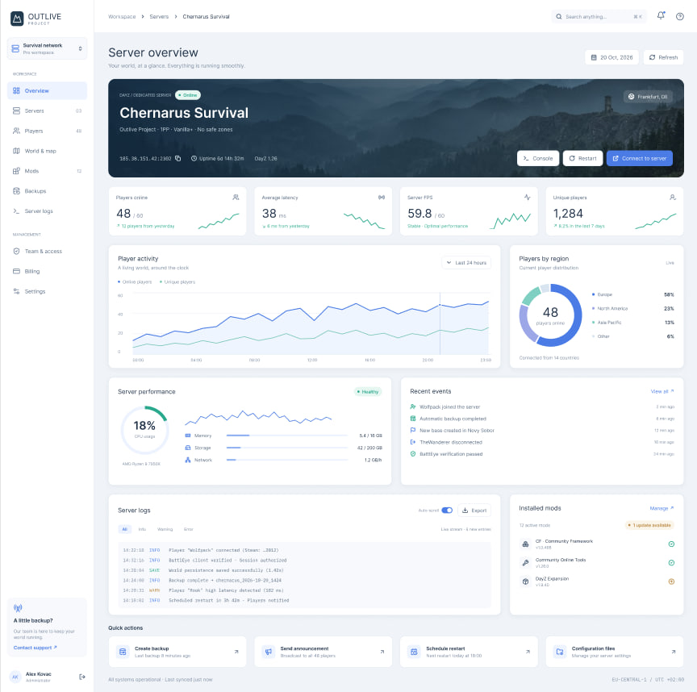
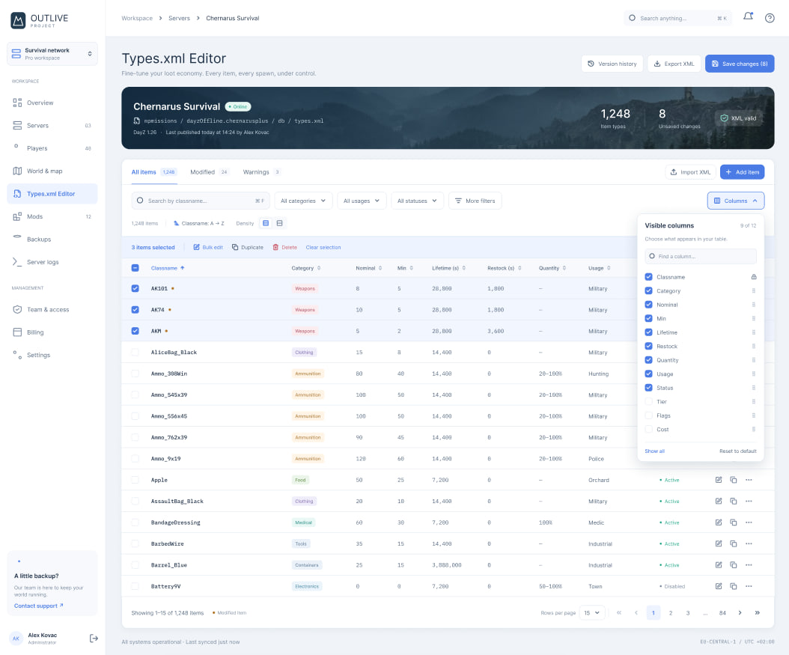
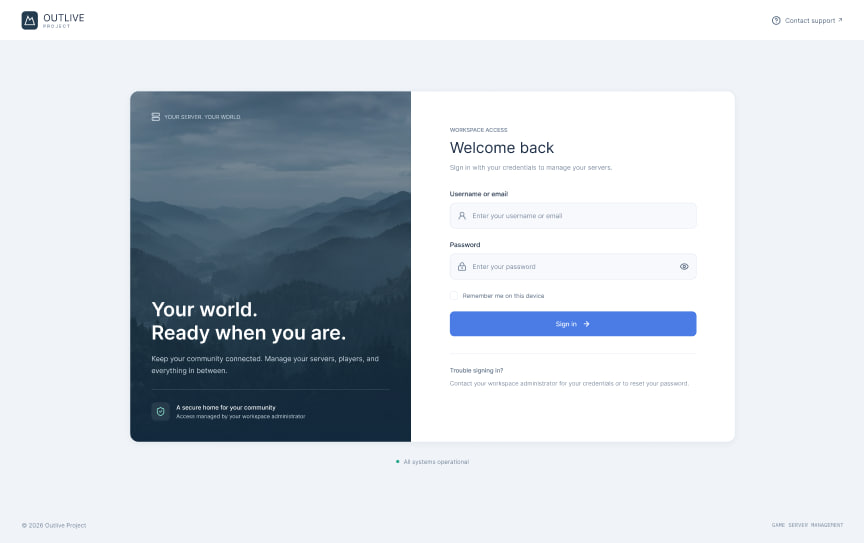

# Aegis: DayZ Server Manager

[](https://github.com/oleh-kazban/dayz-server-manager/actions/workflows/ci.yaml)
[](https://github.com/oleh-kazban/dayz-server-manager/actions/workflows/pr-validation.yaml)
[](https://opensource.org/licenses/MIT)

Running a DayZ server usually means juggling batch scripts, editing large config files by hand, and hoping a missing bracket does not break the server. When a server crashes at 2 AM or a mod update quietly breaks compatibility, you dig through raw log files to find out why.

**Aegis** is a self-hosted web console for administering DayZ Dedicated Servers, on Windows x64 and Linux x64. It runs on the same machine as the game server, supervises the process, edits its configuration safely, and manages Steam Workshop mods. Its purpose is the **DayZ Server Manager** (DSM), and it is built on four pillars: security, consistency, comfort for the people who run servers, and a modern interface.

> **Status: early development.** Aegis is not ready for production use. Part of the console is built, part is a placeholder page, and part is planned. This README says which is which.







_These images are design previews of where the console is going. The current console does not show all of it yet, see below._

---

## What works today

- **Sign-in and sessions.** Password sign-in with short-lived tokens, a profile page, password change, and a list of your active sessions that you can revoke.
- **Servers.** Register a server, check its paths on disk, and pick the active server. Start, stop, restart and force-stop from the browser, with live status.
- **Safe shutdown.** A stop asks the game to shut down through BattlEye RCON (`#shutdown`) so it can save its world, and only kills the process if it does not exit in time. You can also schedule a delayed stop or restart. If Aegis restarts, a running game server keeps running and Aegis finds it again.
- **`serverDZ.cfg` editor.** Syntax and value checks while you type, a lock so two operators do not edit at once, atomic saves with a backup, and a history of revisions you can restore.
- **Launch command.** A preview of the exact command that starts your server, built from your options and mod list. There is no free-text argument field, so a typo cannot add an unsafe argument.
- **Mods.** Add Workshop and local mods, set their load order, search and look up Workshop items and collections, check for updates, and import or export a launcher preset.
- **Steam.** Store SteamCMD settings and credentials (encrypted), sign in with Steam Guard, and run a diagnostics check.
- **Interface.** 12 themes (six light, six dark), responsive layout, live updates through server-sent events, and an in-app help modal.

## What is not built yet

These are planned. Some pages exist in the console as placeholders.

- Download and update of the game server and of mods with SteamCMD, and `.bikey` key handling
- The `types.xml` economy workbench and the world map
- Log viewer pages, host and process telemetry, player management
- Backups and restore, scheduled restarts, Discord notifications
- Installer packages, services (Windows and systemd), and in-app updates
- Translations (English only for now)

The full list, with status, is the [feature map](docs/product/feature-map.md). Finished work is listed in the [release history](history.md).

---

## Documentation

- **[Operator cheatsheet and FAQ](faq.md):** default ports, why a graceful shutdown matters, how mod signature keys work, and what to back up.
- **[Release history](history.md):** completed work, generated from the backlog.
- **In-app help:** press <kbd>Shift + ?</kbd> anywhere in the console, or use the help icon in the header.
- **[Project documentation](docs/README.md):** architecture, conventions and the product plan, for people who work on Aegis.

---

## How it works

Aegis is a standalone, self-hosted application that runs on the same machine (or local network) as your DayZ server:

```text
[ DayZ Dedicated Server ]
         ^
         | Process control, RCON (#shutdown), game file access
         v
[ Aegis backend (Fastify) ] <---> [ SQLite database ]
         ^
         | REST API (/api/v1) + Server-Sent Events
         v
[ Aegis web console (React 19) ]  (browser on a PC, tablet or phone)
```

- **No cloud.** Aegis runs on your own hardware. It talks to Steam only to sign in and to look up Workshop items.
- **Your game files stay as they are.** Aegis does not change DayZ's file layout. Your configs and storage remain standard DayZ files.

---

## Technical Stack

[](https://react.dev/)
[](https://www.typescriptlang.org/)
[](https://nodejs.org/)
[](https://fastify.dev/)
[](https://tailwindcss.com/)
[](https://vite.dev/)
[](https://www.sqlite.org/)
[](https://nx.dev/)
[](https://pnpm.io/)

Built from the ground up as a modern, high-throughput monorepo:

- **Frontend:** React 19, Vite, TanStack Router (100% type-safe search parameters), TanStack Query v5, and Tailwind CSS v4.
- **Backend:** Node.js, Fastify modular REST engine, Server-Sent Events (SSE) for sub-second telemetry streaming, and SQLite via Drizzle ORM.
- **Monorepo Architecture:** Integrated Nx workspace with `pnpm` and strict module boundary enforcement (`@nx/enforce-module-boundaries`).

---

## Getting started (development)

### Prerequisites

- **Node.js:** the latest LTS release (currently 26)
- **pnpm:** `pnpm@12.10.1` (run `corepack enable` to get it)

### Install and run

1. **Clone the repository:**

   ```bash
   git clone https://github.com/oleh-kazban/dayz-server-manager.git
   cd dayz-server-manager
   ```

2. **Install dependencies:**

   ```bash
   pnpm install
   ```

3. **Start the development servers** (in two terminals):

   ```bash
   pnpm start:web      # web console on http://localhost:4200
   pnpm start:server   # backend on http://localhost:5000
   ```

   Open [http://localhost:4200](http://localhost:4200) in your browser.

4. **Sign in.** On the first start the backend creates a temporary setup account and writes its username and password to `manager-data/setup-credentials.txt`. The console prints where the file is and when it expires. Sign in with these credentials. Aegis then opens the setup screen, where you choose the username and password of the root account. The setup account is deleted when you finish. If the setup credentials are lost or have expired (they last 60 minutes), restart Aegis to create new ones. There is no default account or password.

Settings, environment variables and Windows notes are in [getting started](docs/engineering/getting-started.md).

---

## Workspace Commands

| Command                | Purpose                                                                |
| :--------------------- | :--------------------------------------------------------------------- |
| `pnpm start:web`       | Starts the web console development server (`http://localhost:4200`)    |
| `pnpm start:server`    | Starts the Fastify backend dev server (`http://localhost:5000`)        |
| `pnpm docs:sync`       | Synchronizes static documentation and compiles backlog release history |
| `pnpm build`           | Compiles production builds for all applications and packages           |
| `pnpm typecheck`       | Runs project-wide TypeScript verification (`tsc --noEmit`)             |
| `pnpm lint`            | Runs ESLint Flat Config with module boundary and import order checks   |
| `pnpm lint:fix`        | Automatically fixes linting and import sorting violations              |
| `pnpm format:check`    | Checks code formatting against Prettier rules                          |
| `pnpm format`          | Auto-formats all source files with Prettier                            |
| `pnpm check:cycles`    | Detects circular dependencies across apps and libraries (`madge`)      |
| `pnpm test`            | Runs the Vitest suites of every project                                |
| `pnpm test:coverage`   | Runs every test suite with coverage reporting                          |
| `pnpm storybook`       | Starts Storybook for `@aegis/ui` (`http://localhost:6006`)             |
| `pnpm build-storybook` | Builds a static Storybook for the `@aegis/ui` component kit            |

---

## Project structure

```text
dayz-server-manager/
├── apps/
│   ├── web/          # React 19 web console
│   └── server/       # Fastify backend: REST API (/api/v1) and server-sent events
├── libs/
│   ├── ui/           # @aegis/ui component kit and themes (Storybook)
│   ├── api-client/   # Typed HTTP client, one module per API area
│   ├── api-contracts/# Shared Zod request and response schemas
│   ├── database/     # SQLite schema, migrations, password hashing and the secret vault
│   ├── dayz-config/  # serverDZ.cfg parser and rules, launch command compiler
│   ├── platform/     # Process managers for Windows and Linux
│   └── rcon/         # BattlEye RCON client over UDP
├── docs/             # Project documentation
├── faq.md            # Operator cheatsheet
├── history.md        # Release history (generated)
└── LICENSE
```

---

## License

This project is licensed under the [MIT License](LICENSE).
