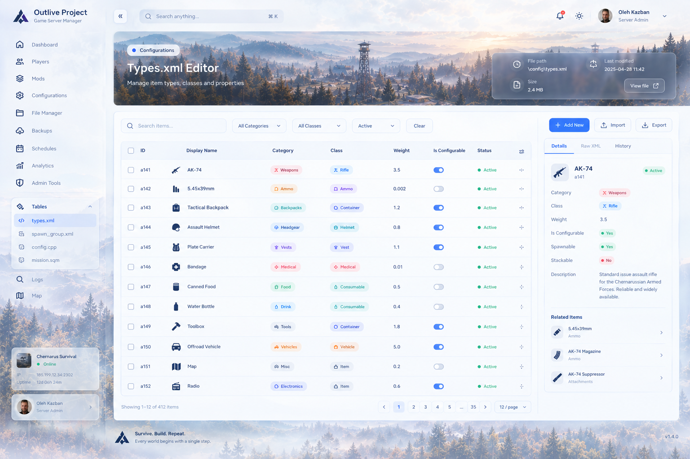
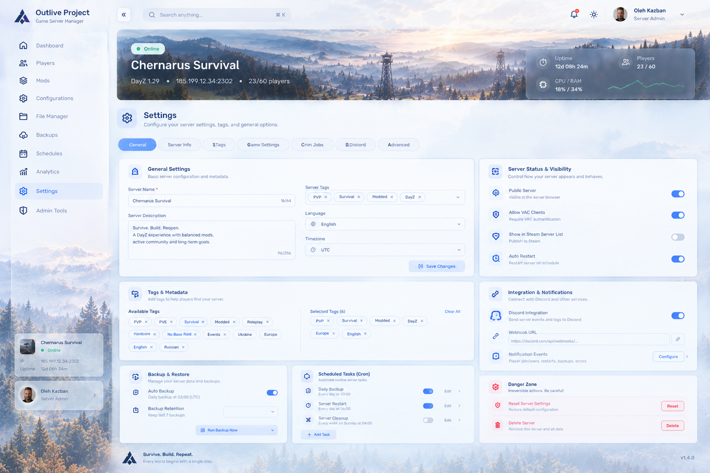

# DayZ Server Manager

Running a DayZ server usually means juggling a mess of batch scripts, manually editing massive XML files in text editors, and praying a missing bracket doesn't break loot spawns across the entire map. When a server crashes at 2 AM or a mod update quietly breaks compatibility, diagnosing the issue means digging through half a dozen raw log files.

**DayZ Server Manager (DSM)** is a modern, self-hosted web control panel built to take the pain out of managing DayZ Dedicated Servers. Whether you are hosting a private server for a few friends or running a high-pop community server on a dedicated box, DSM gives you a clean, responsive interface to supervise your server, tweak configs safely, and keep everything running smoothly.


---

## What It Does

### 1. Live Telemetry & Process Control

- **One-click Lifecycle:** Start, stop, and restart your server directly from the browser.
- **Safe Shutdowns:** Graceful stop routines give players advance notice and flush persistence to disk, preventing inventory rollbacks.
- **Real-time Vital Signs:** Live monitoring of host CPU load, RAM allocation, active player slots, and server tickrate (FPS) via real-time event streaming.
- **Automatic Crash Recovery:** Detects unexpected process exits and restarts the server automatically.

### 2. High-Performance Economy Workbench (`types.xml`)

DayZ's `types.xml` contains anywhere from 2,000 to over 20,000 item definitions. Opening and editing this file in standard editors is sluggish and prone to syntax errors that can ruin a wipe.



- **Instant Filtering:** Filter 20,000+ items by category, tier, usage, or name in under 10 milliseconds.
- **Batch Adjustments:** Easily scale nominal values, lifetimes, or restock timers across entire item classes (e.g., weapons, military loot, medical gear).
- **Pre-commit XML Validation:** DSM validates syntax and structure before anything is written to disk, ensuring broken XML never makes it to your server files.
- **Visual Diff Inspector:** Review every changed value side-by-side before applying changes to your live mission.

### 3. Server Configuration & Scheduled Automation



- **Automated Cron Jobs:** Schedule daily backups, periodic server restarts with warnings, and cleanup routines.
- **Tags & Metadata:** Manage server browser tags, visibility, BattlEye/VAC enforcement, and Steam listing parameters.
- **Discord Integration:** Stream server status events, player milestones, and critical crash alerts directly to Discord webhooks.

### 4. Mod & Workshop Management

- **SteamCMD Integration:** Download and update mods from the Steam Workshop without leaving the web interface.
- **Automatic Key Handling:** Copies `.bikey` files directly into your server's `keys/` directory on install or update.
- **Load Order Resolution:** Organize and toggle server-side and client-side mods with clear startup parameter generation.

### 5. Snapshots & One-Click Rollbacks

- **Scheduled Backups:** Automated snapshots of mission files, server profiles, and the hive persistence database (`storage_1`).
- **Instant Recovery:** If a corrupted mod or bad config breaks your world, restore a known good snapshot with one click.
- **Safe File Commits:** All file operations use atomic writes (`.tmp` write + swap) and pre-save backups (`.bak_{timestamp}`) to prevent partial writes.

### 6. Searchable Logs & Audit Trail

- **Log Streaming:** Live console output, server logs (`.rpt`, `.ADM`), and crash reports in a searchable, filterable viewer.
- **Administrative Audit:** Track who restarted the server, what config values were modified, and when backups were restored.

---

## How It Works

DSM is designed as a standalone, self-hosted appliance that runs on the same machine (or local network) as your DayZ server:

```text
[ DayZ Dedicated Server ]
         ^
         | Process signals, RCON (#shutdown), game file access
         v
[ DSM Fastify Backend ] <---> [ SQLite Database (manager.sqlite) ]
         ^
         | REST API (/api/v1) + Server-Sent Events (SSE)
         v
[ DSM React 19 Frontend ] (Web browser on PC, tablet, or phone)
```

- **Zero Cloud Lock-in:** DSM runs entirely on your own hardware (Windows VPS, Linux box, or local gaming rig). No third-party accounts or external dependencies required.
- **Game Files Stay on Disk:** DSM does not replace DayZ's native file layout. Your XMLs, configs, and storage files remain standard DayZ files.

---

## Technical Stack

Built from the ground up as a modern, high-throughput monorepo:

- **Frontend:** React 19, Vite, TanStack Router (100% type-safe search parameters), TanStack Query v5, and Tailwind CSS v4.
- **Backend:** Node.js, Fastify modular REST engine, Server-Sent Events (SSE) for sub-second telemetry streaming, and SQLite via Drizzle ORM.
- **Development Workflow:** Integrated Mock Service Worker (MSW v2) layer, allowing full frontend UI and telemetry simulation without needing a live DayZ server installed.
- **Monorepo Architecture:** Integrated Nx workspace with `pnpm` and strict module boundary enforcement (`@nx/enforce-module-boundaries`).

---

## Getting Started (Development)

### Prerequisites

- **Node.js:** v20.x or v22.x LTS
- **pnpm:** `pnpm@12.10.1` (or install via `corepack enable`)

### Installation & Setup

1. **Clone the repository:**

   ```bash
   git clone https://github.com/your-username/dayz-server-manager.git
   cd dayz-server-manager
   ```

2. **Install dependencies:**

   ```bash
   pnpm install
   ```

3. **Start the development server:**
   ```bash
   pnpm dev
   ```
   Open [http://localhost:4200](http://localhost:4200) in your browser. The frontend starts in **mock-first mode** using MSW and an internal SSE telemetry simulator, so you can explore the dashboard and control features immediately.

---

## Workspace Commands

| Command             | Purpose                                                              |
| :------------------ | :------------------------------------------------------------------- |
| `pnpm dev`          | Starts the web console development server (`http://localhost:4200`)  |
| `pnpm build`        | Compiles production builds for all applications and packages         |
| `pnpm typecheck`    | Runs project-wide TypeScript verification (`tsc --noEmit`)           |
| `pnpm lint`         | Runs ESLint Flat Config with module boundary and import order checks |
| `pnpm lint:fix`     | Automatically fixes linting and import sorting violations            |
| `pnpm format:check` | Checks code formatting against Prettier rules                        |
| `pnpm format`       | Auto-formats all source files with Prettier                          |
| `pnpm check:cycles` | Detects circular dependencies across apps and libraries (`madge`)    |

---

## Project Structure

```text
dayz-server-manager/
├── apps/
│   ├── web/                     # React 19 SPA (Control Plane Console)
│   │   ├── src/
│   │   │   ├── api/             # Typed API client
│   │   │   ├── components/      # UI components & layouts
│   │   │   ├── hooks/           # Server state & telemetry hooks
│   │   │   ├── mocks/           # MSW v2 handlers & mock SSE stream
│   │   │   ├── styles/          # Tailwind CSS v4 tokens
│   │   │   └── types/           # Domain schemas & types (Zod)
│   │   ├── index.html
│   │   ├── project.json         # Nx project targets (serve, build, lint, typecheck)
│   │   └── vite.config.ts       # Vite 6 + Tailwind v4 bundler config
│   │
│   └── server/                  # Fastify REST backend daemon (Scaffold ready)
│
├── .github/                     # GitHub Actions CI & PR validation pipelines
├── .husky/                      # Git hooks (pre-commit lint-staged, pre-push cycle check)
├── eslint.config.js             # ESLint v10 Flat Config
├── nx.json                      # Nx task orchestrator configuration
├── package.json                 # Centralized monorepo manifest
├── pnpm-workspace.yaml          # Pnpm workspace definition & build script permissions
└── tsconfig.base.json           # Master TypeScript compiler options and path mappings
```

---

## Roadmap

- [x] Monorepo architecture & quality tooling (Nx, pnpm, ESLint v10, Prettier, Husky)
- [x] Client application skeleton with React 19, Vite, and Tailwind CSS v4
- [x] MSW v2 mock layer and real-time SSE telemetry simulator
- [ ] Dashboard shell with real-time process telemetry and quick actions
- [ ] High-performance virtualized `types.xml` workbench with Web Worker diff engine
- [ ] Fastify REST backend (`/api/v1`) with native child process supervision
- [ ] SteamCMD workshop downloader and automated `.bikey` extraction
- [ ] SQLite persistence layer for audit logs, task history, and backup metadata
- [ ] Cross-platform service packaging (WinSW on Windows, systemd on Linux)

---

## License

This project is licensed under the [MIT License](LICENSE).
